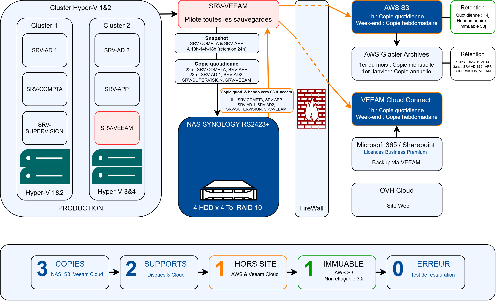

# DATASC.SEA — Audit de Risques & Refonte d'Infrastructure Sécurisée

**Projet Fil Rouge — Formation Administrateur d'Infrastructures Sécurisées / Systèmes & Réseaux (LIORA, 2026)**

[-EE3124?style=for-the-badge&logo=fortinet&logoColor=white)](docs/03-matrice-acl.md)

---

## Contexte & Enjeux métier

**DATASC.SEA** est une PME basée à **Bayonne** (20 collaborateurs répartis sur 5 services : Direction, RH & Comptabilité, Commercial, Data Analyst, R&D) spécialisée dans l'analyse des fonds marins par transmission de données en temps réel. En phase d'hypercroissance après une levée de fonds de plusieurs millions d'euros, l'entreprise reposait sur un SI obsolète (réseau plat derrière une box grand public, matériel non redondé, sauvegardes saturées, baie ouverte en zone inondable près de l'Adour).

L'objectif du projet a été de conduire un audit complet des risques et de concevoir une **infrastructure hybride résiliente, cloisonnée et scalable**, accompagnant l'ouverture d'un poste d'administrateur dédié.

| Audit des risques | Architecture cible | Sauvegarde & Résilience | Budget & TCO 3 ans |
| :---: | :---: | :---: | :---: |
| **41 risques** identifiés **28 critiques** (`>= 9/10`) dont **16 à `10/10`** | **12 VLANs** sémantiques **Cluster HA FGCP** + **LACP `20 Gbps`** | Stratégie **`3-2-1-1-0`** Immuabilité **AWS S3 `30 j`** | **CAPEX :** `40 844 € HT` **OPEX :** `19 718 € HT/an` **TCO 3 ans :** `99 998 € HT` |

---

> [!IMPORTANT]
> ### Mon rôle sur le projet
>
> Projet réalisé en équipe de **3 personnes** couvrant les volets **Système**, **Réseau** et **Sauvegarde**.
>
> Nous nous sommes donc partagé les tâches, j'ai pris en charge la conception complète de l'architecture cible :
> - **Topologie réseau & haute disponibilité** : architecture Dual-WAN (`FTTO` + `FTTH`), cluster actif/passif **2× Fortinet FortiGate 60F (FGCP)** en kit rack `1U` et commutation redondée sur **2 switchs Netgear GS752TXv3 autonomes (non-stackés)** reliés en **Trunk LACP `20 Gbps`**.
> - **Plan d'adressage & segmentation** : découpage sémantique en **12 VLANs** (dont isolation stricte du `VLAN 99` Admin et du `VLAN 220` Backup).
> - **Sécurité périmétrique & Zero-Trust** : rédaction de la **matrice ACL complète** (`Règles 1 à 13` + `Règle 999 Deny All`), sécurisation des flux entrants de télémétrie (refus du NAT SQL `TCP 1433`), **VPN IPsec** (`FortiClient`) et Wi-Fi **WPA3-Enterprise (`802.1X` / RADIUS)** sur bornes **HPE Aruba AP-505**.
> - **Infrastructure physique** : conception de la **salle serveur dédiée** (reconversion de la salle de réunion 1), implantation de la **baie `42U` verrouillable** (`22U` utilisés / `20U` libres) et redondance électrique par **2 onduleurs APC Smart-UPS X 3000VA**.

---

## Architecture Réseau & Sécurité

> 📄 **[Télécharger le schéma d'architecture réseau en PDF haute définition](deliverables/Schema_Architecture_Reseau.pdf)**

### 4 décisions d'architecture clés

1. **Dual-WAN asymétrique résilient (`FTTO` + `FTTH`) :**
   Une fibre professionnelle **FTTO** (`1 Gbit/s` symétrique, GTR 4h) assure la continuité de la télémétrie temps réel, doublée d'une **FTTH** de secours sur routeur distinct avec bascule automatique gérée par les FortiGate.
2. **Cluster HA FortiGate 60F (`FGCP`) & Passerelles Virtuelles (VIP) :**
   Deux pare-feux synchronisés en actif/passif portent les passerelles virtuelles inter-VLAN (`.14` sur `/28`, `.62` sur `/26`, `.6` sur `/29`), appliquent l'inspection IPS/AV, terminent les tunnels **VPN IPsec** et bloquent tout flux hors matrice ACL (`Règle 999 DROP + LOG`).
3. **Switchs autonomes en Trunk LACP `20 Gbps` (vs Stack physique) :**
   Les **2 Netgear GS752TXv3** fonctionnent en mode **autonome** interconnectés par un lien agrégé **LACP `20 Gbps`** (`2× 10G`). Ce choix évite le point de défaillance unique du plan de contrôle partagé (*split-brain*) et autorise la maintenance ou le redémarrage d'un switch sans couper la production.
4. **Adressage sémantique & isolation stricte (`VLAN 99` / `VLAN 220`) :**
   Le 3e octet reflète systématiquement le VLAN ID (`192.168.<ID>.0` pour les utilisateurs, `10.10.<ID>.0` pour l'infra). Le `VLAN 99` (administration) n'accepte les flux SSH/RDP/HTTPS que depuis `10.10.99.61`, le `VLAN 220` (NAS Backup) est uniquement joignable par `SRV-VEEAM`, `Centreon` et l'Admin, et aucune exposition WAN directe du port SQL `1433` n'est autorisée.

---

## Vue d'ensemble Système & Sauvegarde

### Infrastructure hybride pragmatique

- **Sur site (2 clusters Hyper-V sur 4× Dell PowerEdge R350, `Windows Server Standard 2025`)** :
  - **Cluster 1** (`VLAN 240` dédié) : `SRV-AD 1` (AD DS/DNS), `SRV-COMPTA` (Sage 100c), `SRV-SUPERVISION` (`Centreon 24.10 LTS` sur `Ubuntu 24.04 LTS`).
  - **Cluster 2** (`VLAN 245` dédié) : `SRV-AD 2` (AD DS/DNS/RADIUS NPS), `SRV-APP` (`SQL Server 2022`), `SRV-VEEAM` (`Veeam Backup & Replication`).
- **Cloud & SaaS** : migration du serveur de fichiers et de la messagerie `orange.fr` vers **Microsoft 365 Business Premium** (`SharePoint Online`, `OneDrive`, `Exchange Online` avec domaine `OVH`, `Defender for Business`, `MFA`), et hébergement du site Web sur **OVHcloud Pro**.

### Stratégie de sauvegarde `3-2-1-1-0`

> 📄 **[Télécharger le plan de sauvegardes en PDF](deliverables/Plan_de_Sauvegardes.pdf)**

- **3 copies sur 2 supports** : dépôt local sur **NAS Synology RS2423+** (`4×4 To` en **RAID 10**, `8 To` utiles) dans le `VLAN 220` isolé + double externalisation vers **AWS S3 / Glacier** et **Veeam Cloud Connect** (incluant la sauvegarde M365).
- **1 copie hors site & 1 copie immuable (`30 jours`)** : réplication chiffrée vers **AWS S3 Object Lock (30 jours)** pour neutraliser les ransomwares et survivre à un sinistre local (inondation de l'Adour), suivie d'un archivage froid **AWS Glacier** (`3 ans` général, **`10 ans`** légal pour `SRV-COMPTA`).
- **0 erreur** : snapshots horaires (`10h / 14h / 18h`, rétention `24h`) sur Compta et App, sauvegardes nocturnes (`22h / 23h`), et **tests de restauration** hebdomadaires (fichier) et mensuels (VM complète).

---

## Synthèse Budgétaire (CAPEX / OPEX / TCO 3 ans)

| Poste | Détail synthétique | Montant HT |
| :--- | :--- | :---: |
| **CAPEX (Année 1)** | 4× Dell R350, Synology RS2423+, 2× FortiGate 60F, 2× Netgear GS752TXv3, 2× Aruba AP-505, 2× Smart-UPS X 3000VA, Baie 42U, licences Windows Server 2025 + 25 CAL, poste Admin | **`40 844 €`** |
| **OPEX (Annuel)** | FTTO + FTTH (`7 250 €`), M365 Business Premium 21 comptes (`5 040 €`), Veeam + AWS (`5 000 €`), supports constructeurs & FW (`2 390 €`), OVHcloud Pro (`38 €`) | **`19 718 € / an`** |
| **Total Année 1** | **CAPEX + OPEX Année 1** | **`60 562 €`** |
| **TCO sur 3 ans** | **CAPEX + 3 × OPEX** | **`99 998 €`** |

---

## Documentation détaillée & Livrables

### Documentation technique (`docs/`)

| Document | Description |
| :--- | :--- |
| [01 — Analyse des risques](docs/01-analyse-risques.md) | Synthèse de l'audit, 10 priorités et matrice complète des **41 risques** |
| [02 — Plan d'adressage IP](docs/02-plan-adressage-ip.md) | Table des **12 VLANs** sémantiques et affectation des IP statiques par équipement |
| [03 — Matrice ACL Zero-Trust](docs/03-matrice-acl.md) | Règles `1 à 13` + `999 Deny All` et note d'architecture télémétrie sondes |
| [04 — Stratégie de sauvegarde](docs/04-strategie-sauvegarde.md) | Règle `3-2-1-1-0`, dimensionnement serveurs/VMs, planning et rétentions |
| [05 — Budget CAPEX / OPEX](docs/05-budget-capex-opex.md) | Chiffrage détaillé matériel/licences/abonnements et projection **TCO 3 ans** |

### Livrables finaux (`deliverables/`)

- [Rapport d'analyse de risques complet — DATASC.SEA (PDF, 26 pages)](deliverables/Rapport_Analyse_Risques_DATASC-SEA.pdf)
- [Schéma d'architecture réseau cible (PDF)](deliverables/Schema_Architecture_Reseau.pdf)
- [Plan de sauvegardes 3-2-1-1-0 (PDF)](deliverables/Plan_de_Sauvegardes.pdf)

---

## Compétences démontrées

- **Architecture & Sécurité Réseau** : Segmentation `802.1Q` (12 VLANs), adressage CIDR/VLSM sémantique, pare-feu `Fortinet FortiGate` HA (`FGCP`), filtrage `Zero-Trust` / ACL, `VPN IPsec`, `Dual-WAN` (`FTTO`/`FTTH`), commutation `LACP 20 Gbps` (`Netgear`), Wi-Fi `WPA3-Enterprise` (`802.1X` / `RADIUS` sur `HPE Aruba`).
- **Systèmes & Virtualisation** : `Windows Server 2025`, clusters `Hyper-V HA`, `Active Directory (AD DS)` / `DNS` / `GPO` / `NPS`, `Microsoft SQL Server 2022`, `Ubuntu Server 24.04 LTS`, supervision `Centreon 24.10 LTS` (`SNMPv3`).
- **Cloud, Sauvegarde & PRA** : Stratégie `3-2-1-1-0`, `Veeam Data Platform Premium`, `Veeam Cloud Connect`, `AWS S3 Object Lock` (immuabilité), `AWS Glacier`, `Microsoft 365 Business Premium` (`SharePoint`, `Exchange Online`, `Defender for Business`, `MFA`).
- **Gouvernance, Gestion de Risques & FinOps** : Audit de vulnérabilités (41 risques, matrice Impact × Probabilité), conformité `RGPD` & `ANSSI`, urbanisme salle serveur `42U` & redondance `UPS`, budgétisation `CAPEX` / `OPEX` / `TCO 3 ans`.
